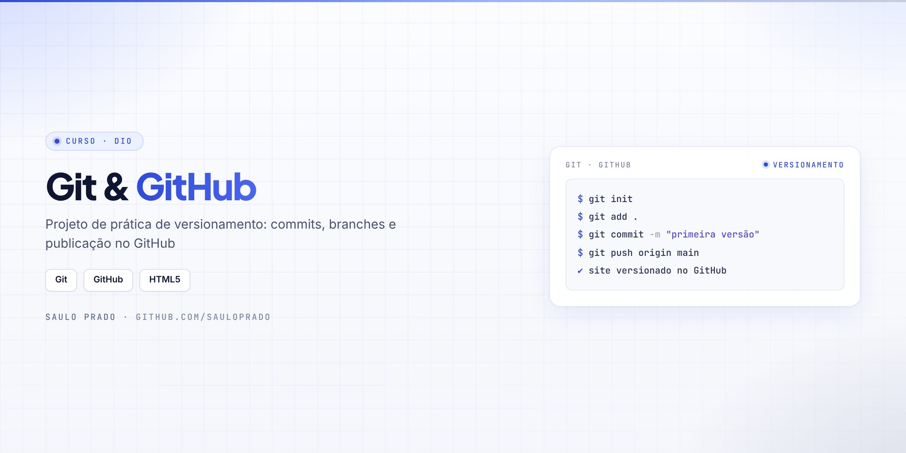
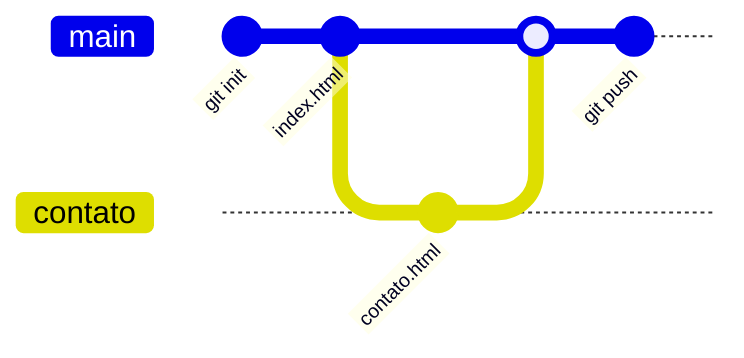

<p align="center">

</p>

<h1 align="center">Git & GitHub</h1>
<p align="center"><i>Projeto de prática de versionamento do curso da DIO</i></p>

<p align="center">


</p>

## Sumário

- [Sobre](#sobre)
- [O que foi praticado](#o-que-foi-praticado)
- [Como visualizar](#como-visualizar)
- [Estrutura do repositório](#estrutura-do-repositório)
- [Autor](#autor)

## Sobre

Projeto criado no **curso de Git e GitHub da DIO** para praticar controle de versão com um site simples: criar o repositório, registrar commits e publicar no GitHub.

## O que foi praticado

| Prática | Conceito |
| --- | --- |
| `git init` · `git clone` | Criar e copiar repositórios |
| `git add` · `git commit` | Registrar alterações |
| `git branch` · `git merge` | Trabalhar com ramificações |
| `git push` | Publicar no GitHub |
| `index.html` · `contato.html` | Site usado como base da prática |



## Como visualizar

```bash
git clone https://github.com/sauloprado/Projeto-Curso-Git.git
```

Abra o `index.html` no navegador.

## Estrutura do repositório

```text
Projeto-Curso-Git/
├── index.html
├── contato.html
└── assets/capa.png
```

## Autor

**Saulo Prado** · Analista de Sistemas · Gestão de Ativos de TI, orçamento, automação e dashboards

[](https://www.linkedin.com/in/saulo-prado-ab4a0b96/)
[](https://github.com/sauloprado)
